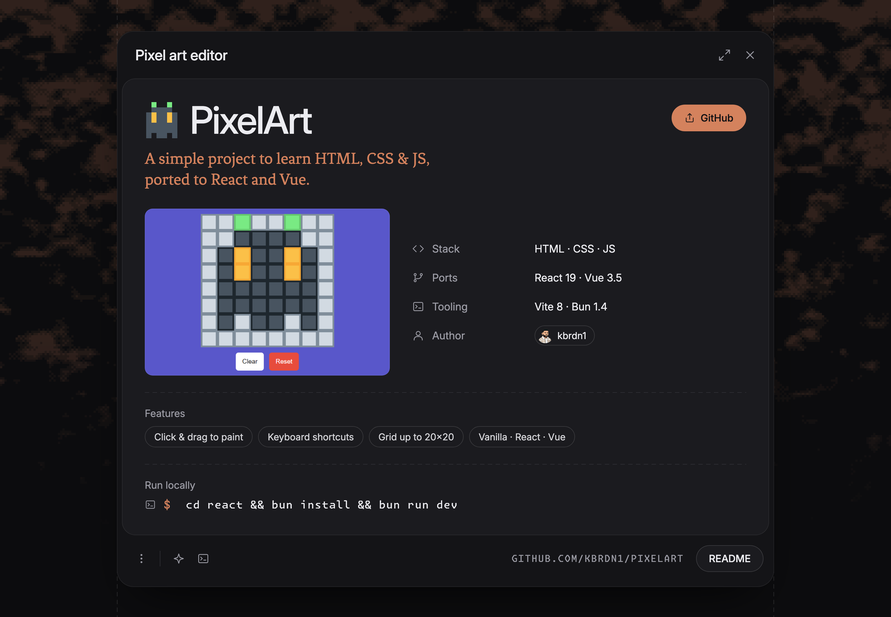

  <picture>
    <source media="(prefers-color-scheme: dark)"  srcset="docs/_assets/promo.png">
    <source media="(prefers-color-scheme: light)" srcset="docs/_assets/promo-light.png">
    
  </picture>

# PixelArt
A simple project to learn HTML, CSS & JS

